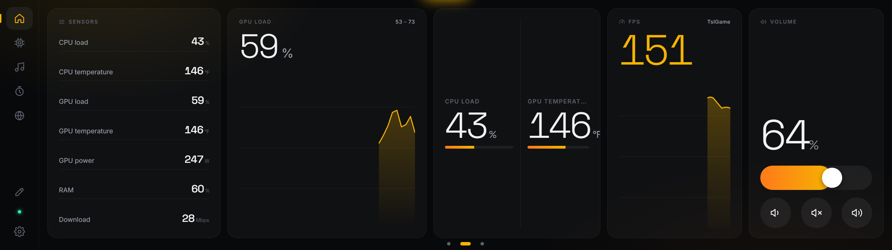
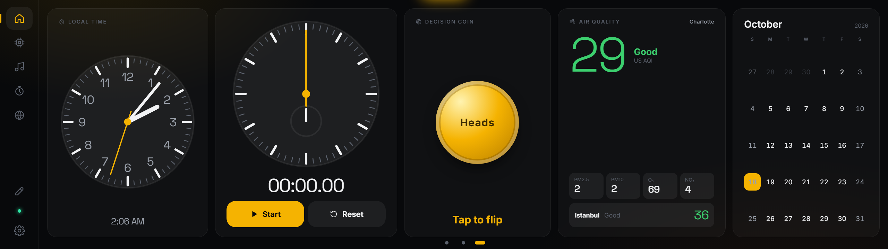
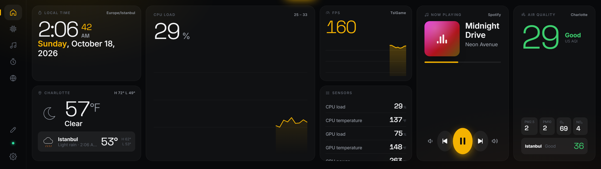
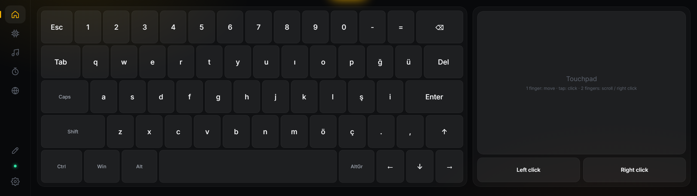
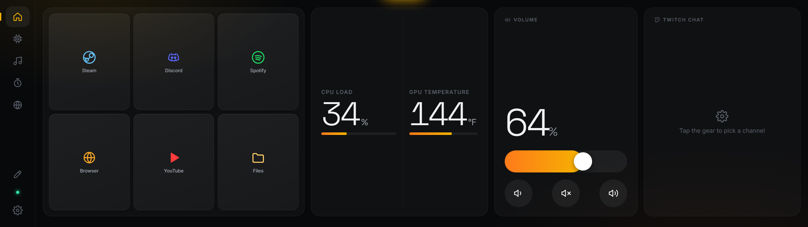

# Edge Deck

**CORSAIR XENEON EDGE** (14.5", 2560×720 dokunmatik) için özel olarak tasarlanmış bir kontrol paneli.
Saat, hava durumu (Charlotte ve İstanbul), canlı sensörler, FPS, müzik ve ses kontrolü, uygulama ve oyun kısayolları, Stream Deck, sanal klavye ve touchpad, YouTube ve Twitch… iCUE'daki bütün bileşenlerin karşılığı, kaydırarak geçilen birden fazla ekranda; hepsi doğrudan Edge'in üzerinden düzenlenebilir.


<p align="center"><a href="#kurulum-2-dakika-teknik-bilgi-gerekmez"><b>Kurulum</b></a> · <a href="#ekran-görüntüleri"><b>Ekran görüntüleri</b></a> · <a href="#temalar"><b>Temalar</b></a> · <a href="#birden-fazla-ekran"><b>Ekranlar</b></a> · <a href="#ekranı-kendiniz-düzenleyin"><b>Düzenleme</b></a> · <a href="#kullanım"><b>Kullanım</b></a></p>

---

## Kurulum (2 dakika, teknik bilgi gerekmez)

1. **Zip dosyasını açın.** `EdgeDeck-Kurulum.zip` dosyasına sağ tıklayın, **Tümünü ayıkla…** deyin ve **Ayıkla**'ya basın.
2. **Açılan klasördeki `Edge Deck Kur.bat` dosyasına çift tıklayın.**
   - Windows mavi bir "Windows bilgisayarınızı korudu" ekranı gösterirse **Ek bilgi**'ye, sonra **Yine de çalıştır**'a tıklayın.
   - Siyah bir pencere açılır ve her şeyi kendisi yapar. Gerekirse Node.js'i de indirir, bu bir dakika sürebilir.
3. **"Edge Deck kuruldu!" mesajı gelince bitti.** Panel XENEON EDGE ekranında açılır.

Bundan sonra bilgisayar her açıldığında panel kendiliğinden başlar. Kapatırsanız masaüstündeki **Edge Deck** simgesiyle tekrar açabilirsiniz.

### Panel Edge ekranında açılmadıysa

iCUE, Edge ekranını kendi widget'ları için kullanıyor olabilir. Şu iki yoldan birini seçin:

- **Yol 1 (önerilen):** iCUE'yu açın, **XENEON EDGE** cihazına girin ve ekranın iCUE tarafından kontrol edilmesini kapatın. Sonra masaüstündeki **Edge Deck** simgesine çift tıklayın.
- **Yol 2 (iCUE içinde):** iCUE'da Edge'e bir **Web URL** widget'ı ekleyin, boyutunu **XL** yapın ve adres olarak şunu yazın:
  ```
  https://localhost:5281
  ```
  iCUE sadece `https` adresleri açıyor. Bu yüzden kurulum sırasında Windows bir **güvenlik uyarısı** gösterir ("Bu sertifikayı yüklemek istiyor musunuz?"). **Evet** deyin. Bu sertifika sadece bu bilgisayarın kendi adresi (`localhost`) için geçerlidir; başka hiçbir site için kullanılamaz. Program kaldırılınca sertifika da kaldırılır.

---

## Birden fazla ekran

Ana ekran tek sayfadan ibaret değil. Bileşenler istediğiniz kadar **ekrana** dağıtılabilir:

- Ana ekranda **sağa / sola kaydırarak** ekranlar arasında geçin.
- Alttaki **noktalara** dokunarak da geçebilirsiniz. Soldaki **ev** simgesine tekrar dokunmak ilk ekrana döner.
- Hazır gelen ekranlar:
  1. Günlük
  2. Sensörler ve performans
  3. Saatler ve eğlence
- Düzenleme modunda alttan **+ Ekran** ile yeni ekran ekleyin; **Ekranı sil** ile kaldırın.




---

## Ekranı kendiniz düzenleyin

Hiçbir dosyaya dokunmadan, doğrudan Edge'in üzerinden:

1. Soldaki **kalem** simgesine dokunun (ya da ana ekranda boş bir yere basılı tutun).
2. Her bileşenin altında bir düzenleme çubuğu çıkar:
   - **‹ ›** ile sola veya sağa taşıyın. En kenardan devam ederseniz bileşen yan ekrana geçer.
   - **S / M / L** ile hazır boyut seçin.
   - **Alt alta** simgesiyle bileşeni bir öncekinin **altına** yerleştirin; iki bileşen aynı sütunu paylaşır.
   - **⚙** ile ayarlarını açın.
   - **Çöp kutusu** ile kaldırın.
3. **Sürükleyerek boyutlandırın:**
   - Her sütunun sağ kenarındaki **sarı çubuğu** çekerek genişliği serbestçe ayarlayın.
   - Alt alta duran iki bileşenin arasındaki çubukla yükseklik paylaşımını ayarlayın.
4. En sağdaki **+ Bileşen ekle** kutusundan yenisini ekleyin.
5. Bitince üstteki **Bitti** düğmesine dokunun.




### Bileşenler

iCUE'daki Xeneon Edge bileşenlerinin hepsinin karşılığı var (Windows bildirimleri hariç; Windows bunu sadece mağaza uygulamalarına izin veriyor):

| Grup | Bileşenler |
|---|---|
| **Günlük** | Saat ve tarih, Kadran saat, Hava durumu, Hava kalitesi (AQI), Takvim, Dünya saatleri, Geri sayım, Not, Odak sayacı |
| **Sistem** | Sistem monitörü, Sensör listesi, Sensör grafiği, 2 Sensör, FPS |
| **Medya** | Şimdi çalıyor, Ses (sürgü + sessiz), YouTube, Twitch Canlı, Twitch Sohbet, Fotoğraf ve video slaytı |
| **Kontrol** | Uygulama başlatıcı, Stream Deck, Sanal klavye, Sanal touchpad |
| **Web** | Web sitesi (iFrame / Web URL), SimHub |
| **Eğlence** | Yazı tura, Kronograf, Kronometre |

Öne çıkanlar:

- **Uygulama başlatıcı / Stream Deck** (⚙ ile düzenlenir):
  - **Yüklü programlar** kendi simgeleriyle, **Steam oyunları** kapak görselleriyle ve **web siteleri** eklenebilir.
  - **Klavye kısayolları** eklenebilir (örn. Ctrl+Shift+M ile mikrofonu kapatma, OBS kısayolları).
  - **Medya tuşları**, **hazır metinler** ("gg wp") ve **ekran değiştirme** düğmeleri eklenebilir.
  - Var olan bir düğmeye dokunup adını, simgesini, rengini ve neyi açtığını değiştirebilirsiniz.
- **Sensörler:** CPU, GPU (yük, sıcaklık, güç, fan, saat hızı, bellek), RAM, ağ, diskler, ses, FPS. [LibreHardwareMonitor](https://github.com/LibreHardwareMonitor/LibreHardwareMonitor) açıksa onun bütün sensörleri de (fanlar, voltajlar, CPU sıcaklığı…) listeye eklenir.
- **FPS:** MSI Afterburner / RivaTuner açıkken öndeki oyunun FPS değerini gösterir.
- **Sanal klavye ve touchpad:** Edge'den ana ekrandaki uygulamaya yazı yazın ya da fareyi kullanın. Türkçe Q ve İngilizce düzen var.
- **Edge Deck odak çalmaz:** Edge'e dokunduğunuzda oyun ya da kullandığınız program önde kalır. Sadece Edge Deck'in kendi yazı alanlarına dokunduğunuzda klavye ona geçer.





---

## Ekran görüntüleri

Hepsi Edge'in gerçek çözünürlüğünde (2560×720). Görüntülerdeki veriler örnek veridir.

**Türkçe arayüz:** Ayarlar'dan tek dokunuşla.


**Sistem:** CPU çekirdekleri, ekran kartı, ağ ve disk grafikleri.


**Medya:** Spotify, YouTube ya da Windows'ta çalan her şey.


**Odak:** Pomodoro sayacı, yapılacaklar ve notlar.


**Dünya saatleri:** Charlotte, İstanbul ve istediğiniz şehirler.


**Farklı ana ekran düzeni:** Bileşenler Ayarlar'dan açılıp kapatılır ve sıralanır.


**Ayarlar:** Dil, tema, renk, düzen ve şehirler.


## Temalar

6 hazır tema ve 9 vurgu rengi var.

| | |
|---|---|
| **Aurora**  | **Synthwave**  |
| **Ember** (takvim + dünya saatleri düzeniyle)  | **Terminal**  |
| **Paper** (gündüz için açık tema)  | **Obsidian** (varsayılan)  |

---

## Kullanım

- Soldaki simgelerle sayfalar arasında geçin. Ana ekranda sağa/sola kaydırmak ana ekranlar arasında geçirir.
- Sol alttaki **yeşil nokta**, panelin bilgisayara bağlı olduğunu gösterir.

| Sayfa | Ne var |
|---|---|
| 🏠 **Ana ekran** | Saat, İstanbul saati, hava durumu, sistem göstergeleri, çalan müzik, uygulama kısayolları |
| ⚙️ **Sistem** | CPU çekirdekleri, ekran kartı (yük, VRAM, watt, sıcaklık), ağ grafiği, RAM ve diskler |
| 🎵 **Medya** | Büyük "şu an çalıyor" ekranı ve ses kontrolü (Spotify, YouTube, tarayıcı…) |
| ⏱️ **Odak** | Pomodoro sayacı, yapılacaklar listesi, notlar |
| 🌍 **Dünya** | Charlotte, İstanbul ve diğer şehirlerin saatleri |
| ⚙ **Ayarlar** | Dil, tema, renk, ana ekran düzeni, hava durumu şehirleri |

### Dili Türkçe yapmak
**Ayarlar** (sol alttaki dişli) → en üstteki **Language / Dil** → **Türkçe**

### Ayarlarda neler var
- **Dil:** English / Türkçe
- **6 tema:** Obsidian, Aurora, Synthwave, Ember, Terminal, Paper, ayrıca vurgu rengi
- **Ana ekran:** Bileşenleri aç/kapat ve sırala. Takvim, dünya saatleri ve odak sayacı da eklenebilir.
- 12 / 24 saat, °F / °C
- **Hava durumu:** Ana şehir ve ikinci şehir (varsayılan Charlotte ve İstanbul)
- **Gece karartma:** Gece parlaklığı otomatik düşürür.
- **Ekran koruyucu**

---

## Kaldırma
**Başlat menüsü** → **Edge Deck** → **Edge Deck Kaldır**

---

## İsteğe bağlı

- **CPU sıcaklığı:** Windows bunu kendiliğinden vermiyor. [LibreHardwareMonitor](https://github.com/LibreHardwareMonitor/LibreHardwareMonitor) kurup *Options → Remote Web Server → Run* açarsanız panelde görünür. Ekran kartı sıcaklığı (NVIDIA) zaten çalışıyor.
- **Güncelleme:** Yeni sürümün zip'ini açıp `Edge Deck Kur.bat` dosyasını tekrar çalıştırın. Ayarlarınız, kısayollarınız ve fotoğraflarınız korunur.

## Sorun giderme

- **Göstergelerde "PC bağlantısı yok" yazıyor:** Masaüstündeki **Edge Deck** simgesine çift tıklayın.
- **Dokunuşlar yanlış ekrana gidiyor:** Windows'ta *Denetim Masası → Tablet PC Ayarları → Kur → Dokunmatik giriş* adımına gidin ve istendiğinde Edge ekranına dokunun.
- **Üç/dört parmak hareketleri sorun çıkarıyor:** *Ayarlar → Bluetooth ve cihazlar → Dokunma* bölümünden kapatın.
- **Hava durumu yüklenmiyor:** İnternet bağlantısını kontrol edin. Veriler ücretsiz Open-Meteo servisinden geliyor.

---

<sub>Teknik: Node.js ile çalışan yerel bir sunucu (sadece `localhost`, dışarıdan erişilemez) ve dokunmatik bir web arayüzü. İstatistikler PowerShell üzerinden Windows'tan okunur. Ayarlar `settings.json` dosyasında saklanır.</sub>
