# Edge Deck

**CORSAIR XENEON EDGE** (14.5", 2560×720 dokunmatik) için özel olarak tasarlanmış bir kontrol paneli.
Saat, hava durumu (Charlotte ve İstanbul), bilgisayarın canlı CPU / GPU / RAM değerleri, çalan müzik ve kontrolleri, uygulama kısayolları, odak sayacı, yapılacaklar listesi ve dünya saatleri tek ekranda.

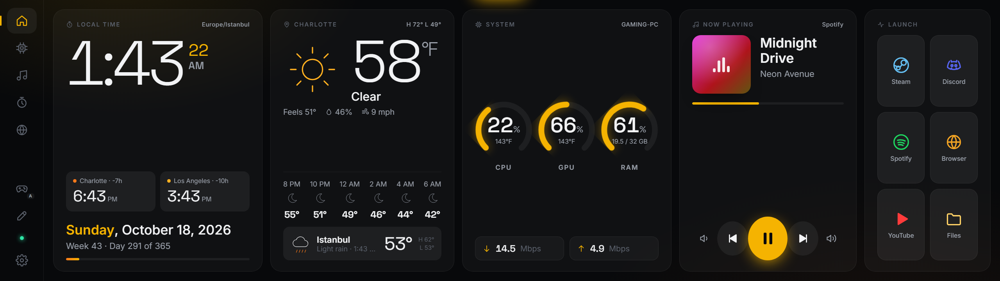

<p align="center"><a href="#kurulum-2-dakika-teknik-bilgi-gerekmez"><b>Kurulum</b></a> · <a href="#ekran-görüntüleri"><b>Ekran görüntüleri</b></a> · <a href="#temalar"><b>Temalar</b></a> · <a href="#kullanım"><b>Kullanım</b></a></p>

---

## Kurulum (2 dakika, teknik bilgi gerekmez)

1. **Zip dosyasını açın.** `EdgeDeck-Kurulum.zip` dosyasına sağ tıklayın, **Tümünü ayıkla…** deyin ve **Ayıkla**'ya basın.
2. **Açılan klasördeki `Edge Deck Kur.bat` dosyasına çift tıklayın.**
   - Windows mavi bir "Windows bilgisayarınızı korudu" ekranı gösterirse **Ek bilgi**'ye, sonra **Yine de çalıştır**'a tıklayın.
   - Siyah bir pencere açılır ve her şeyi kendisi yapar. Gerekirse Node.js'i de indirir, bu bir dakika sürebilir.
3. **"Edge Deck kuruldu!" mesajı gelince bitti.** Panel XENEON EDGE ekranında açılır.

Bundan sonra bilgisayar her açıldığında panel kendiliğinden başlar. Kapatırsanız masaüstündeki **Edge Deck** simgesiyle tekrar açabilirsiniz.

### Panel Edge ekranında açılmadıysa

iCUE, Edge ekranını kendi widget'ları için kullanıyor olabilir. Şu iki yoldan birini seçin:

- **Yol 1 (önerilen):** iCUE'yu açın, **XENEON EDGE** cihazına girin ve ekranın iCUE tarafından kontrol edilmesini kapatın. Sonra masaüstündeki **Edge Deck** simgesine çift tıklayın.
- **Yol 2 (iCUE içinde):** iCUE'da Edge'e bir **Web URL** widget'ı ekleyin, boyutunu **XL** yapın ve adres olarak şunu yazın:
  ```
  https://localhost:5281
  ```
  iCUE sadece `https` adresleri açıyor. Bu yüzden kurulum sırasında Windows bir **güvenlik uyarısı** gösterir ("Bu sertifikayı yüklemek istiyor musunuz?"). **Evet** deyin. Bu sertifika sadece bu bilgisayarın kendi adresi (`localhost`) için geçerlidir; başka hiçbir site için kullanılamaz. Program kaldırılınca sertifika da kaldırılır.

---

## Ekranı kendiniz düzenleyin

Hiçbir dosyaya dokunmadan, doğrudan Edge'in üzerinden:

1. Soldaki **kalem** simgesine dokunun (ya da ana ekranda boş bir yere basılı tutun).
2. Her bileşenin altında bir düzenleme çubuğu çıkar:
   - **‹ ›** ile sola veya sağa taşıyın.
   - **S / M / L** ile boyutunu değiştirin.
   - **⚙** ile ayarlarını açın.
   - **çöp kutusu** ile kaldırın.
3. En sağdaki **+ Bileşen ekle** kutusundan yenisini ekleyin.
4. Bitince üstteki **Bitti** düğmesine dokunun.

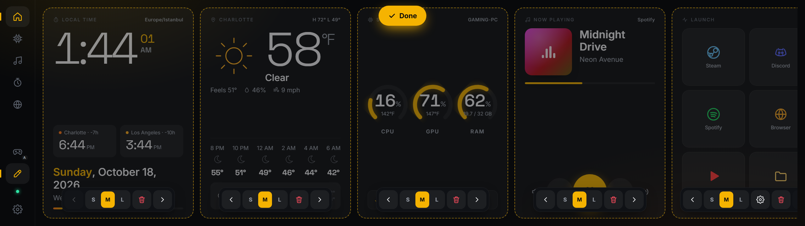
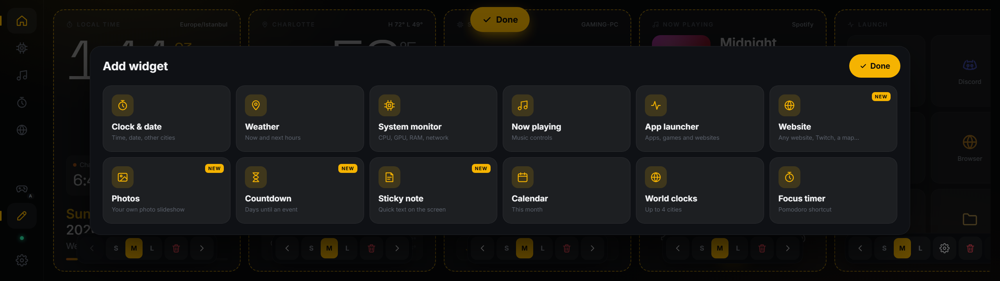

**Eklenebilecek bileşenler:** Saat, hava durumu, sistem, müzik, takvim, dünya saatleri, odak sayacı ve yeni gelenler:

| Bileşen | Ne yapar |
|---|---|
| **Uygulama başlatıcı** | ⚙ ile açılan listeden **bilgisayarda yüklü programları** (kendi simgeleriyle), **Steam oyunlarını** (kapak görselleriyle) ya da **web sitelerini** seçip ekleyin. Birden fazla başlatıcı kutusu kullanılabilir. |
| **Web sitesi** | Herhangi bir site: Twitch, hava haritası, bir kontrol paneli… (Bazı siteler başka sayfaların içinde gösterilmeyi engeller.) |
| **Fotoğraflar** | Kendi fotoğraflarınızdan slayt gösterisi. |
| **Geri sayım** | Bir tarihe kalan gün, saat ve dakika. |
| **Not** | Ekranda duran kısa bir yazı. Üzerine dokunup yazın. |

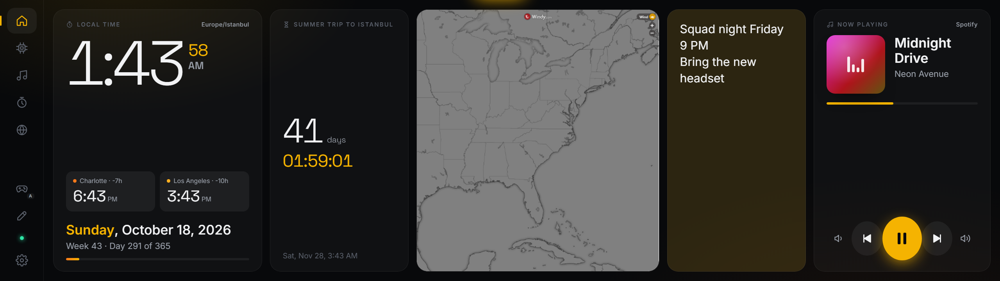

---

## Oyun modu (fare Edge'e kaymasın)

Oyun oynarken fare yanlışlıkla Edge ekranına kayıp oyunun dışına tıklanmasın diye:

- **Otomatik (varsayılan):** Tam ekran bir oyun açıldığında fare oyunun ekranına kilitlenir; oyundan çıkınca serbest kalır.
- **Dokunmatik çalışmaya devam eder:** Oyun sırasında Edge'e dokunup müzik değiştirebilirsiniz. Edge Deck penceresi oyunun önüne geçip onu küçültmez.
- **Elle açıp kapatma:** Soldaki **oyun kolu** simgesine dokunun ("A" = otomatik, "ON" = her zaman açık).
- **Ayarlar** sayfasından tamamen kapatılabilir.

---

## Ekran görüntüleri

Hepsi Edge'in gerçek çözünürlüğünde (2560×720). Görüntülerdeki veriler örnek veridir.

**Türkçe arayüz:** Ayarlar'dan tek dokunuşla.
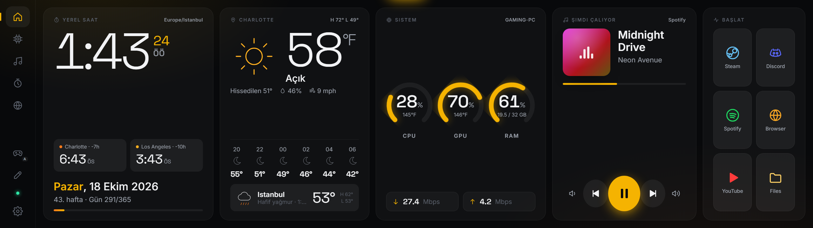

**Sistem:** CPU çekirdekleri, ekran kartı, ağ ve disk grafikleri.
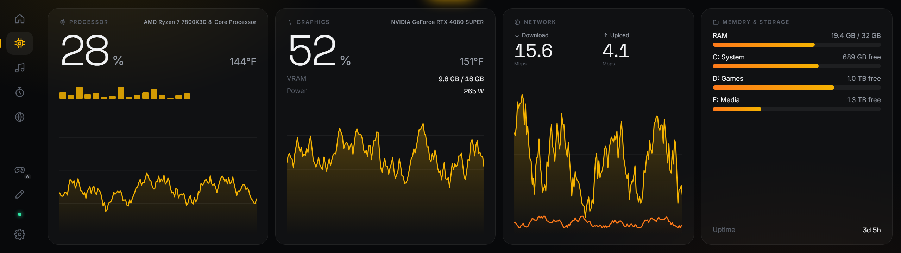

**Medya:** Spotify, YouTube ya da Windows'ta çalan her şey.
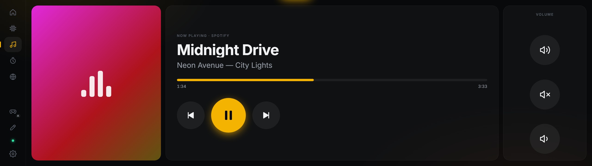

**Odak:** Pomodoro sayacı, yapılacaklar ve notlar.
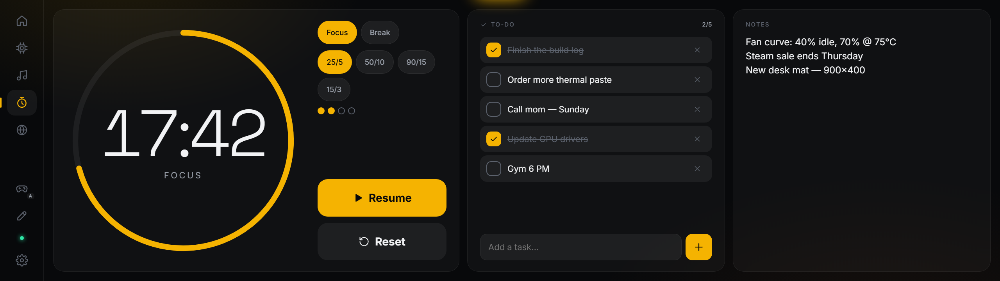

**Dünya saatleri:** Charlotte, İstanbul ve istediğiniz şehirler.
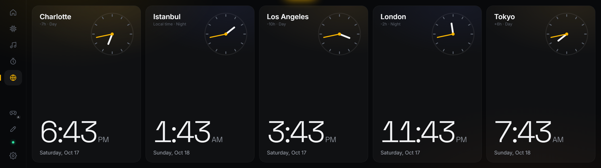

**Farklı ana ekran düzeni:** Bileşenler Ayarlar'dan açılıp kapatılır ve sıralanır.
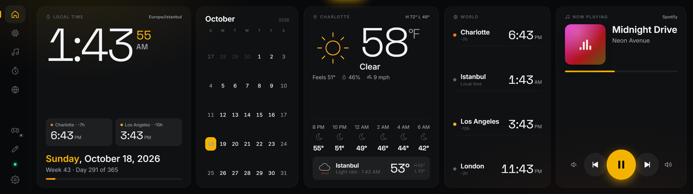

**Ayarlar:** Dil, tema, renk, düzen ve şehirler.
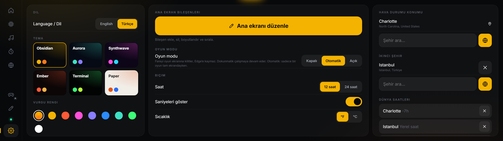

## Temalar

6 hazır tema ve 9 vurgu rengi var.

| | |
|---|---|
| **Aurora** 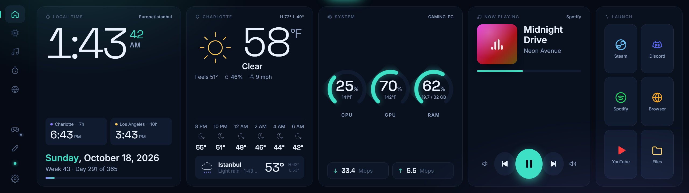 | **Synthwave** 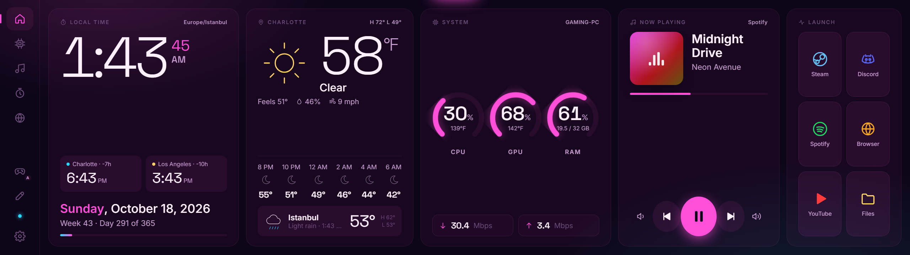 |
| **Ember** (takvim + dünya saatleri düzeniyle) 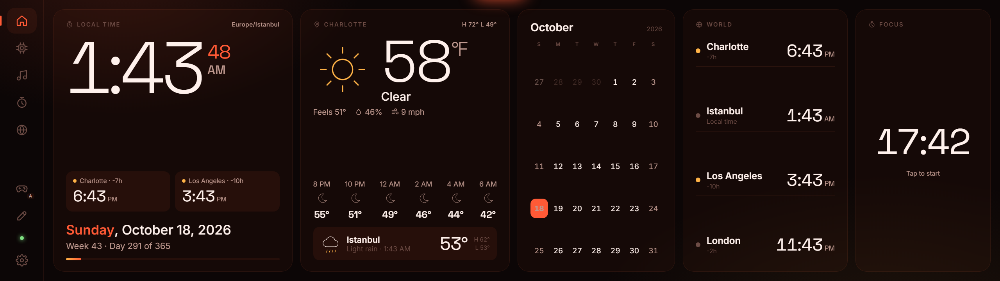 | **Terminal** 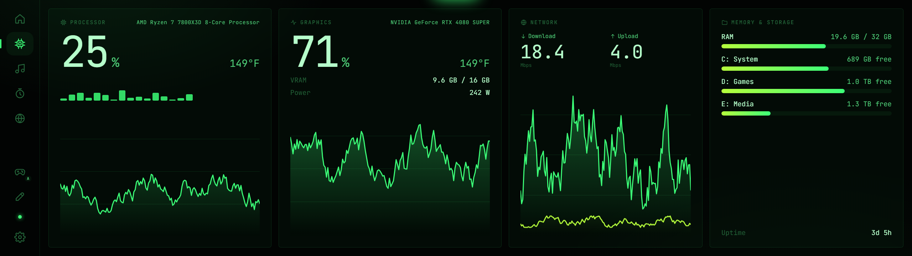 |
| **Paper** (gündüz için açık tema) 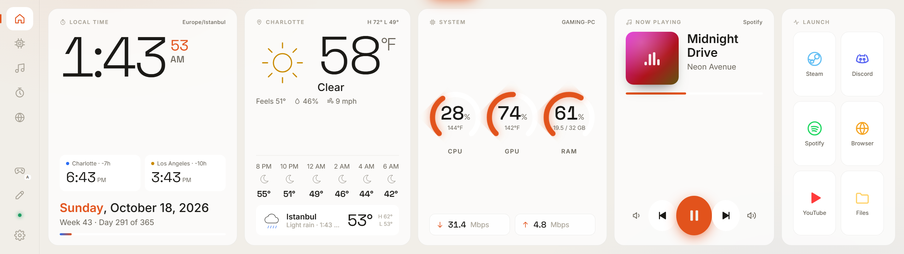 | **Obsidian** (varsayılan)  |

---

## Kullanım

- Sayfalar arasında **sağa/sola kaydırarak** ya da soldaki simgelere dokunarak geçin.
- Sol alttaki **yeşil nokta**, panelin bilgisayara bağlı olduğunu gösterir.

| Sayfa | Ne var |
|---|---|
| 🏠 **Ana ekran** | Saat, İstanbul saati, hava durumu, sistem göstergeleri, çalan müzik, uygulama kısayolları |
| ⚙️ **Sistem** | CPU çekirdekleri, ekran kartı (yük, VRAM, watt, sıcaklık), ağ grafiği, RAM ve diskler |
| 🎵 **Medya** | Büyük "şu an çalıyor" ekranı ve ses kontrolü (Spotify, YouTube, tarayıcı…) |
| ⏱️ **Odak** | Pomodoro sayacı, yapılacaklar listesi, notlar |
| 🌍 **Dünya** | Charlotte, İstanbul ve diğer şehirlerin saatleri |
| ⚙ **Ayarlar** | Dil, tema, renk, ana ekran düzeni, hava durumu şehirleri |

### Dili Türkçe yapmak
**Ayarlar** (sol alttaki dişli) → en üstteki **Language / Dil** → **Türkçe**

### Ayarlarda neler var
- **Dil:** English / Türkçe
- **6 tema:** Obsidian, Aurora, Synthwave, Ember, Terminal, Paper, ayrıca vurgu rengi
- **Ana ekran:** Bileşenleri aç/kapat ve sırala. Takvim, dünya saatleri ve odak sayacı da eklenebilir.
- 12 / 24 saat, °F / °C
- **Hava durumu:** Ana şehir ve ikinci şehir (varsayılan Charlotte ve İstanbul)
- **Gece karartma:** Gece parlaklığı otomatik düşürür.
- **Ekran koruyucu**

---

## Kaldırma
**Başlat menüsü** → **Edge Deck** → **Edge Deck Kaldır**

---

## İsteğe bağlı

- **CPU sıcaklığı:** Windows bunu kendiliğinden vermiyor. [LibreHardwareMonitor](https://github.com/LibreHardwareMonitor/LibreHardwareMonitor) kurup *Options → Remote Web Server → Run* açarsanız panelde görünür. Ekran kartı sıcaklığı (NVIDIA) zaten çalışıyor.
- **Güncelleme:** Yeni sürümün zip'ini açıp `Edge Deck Kur.bat` dosyasını tekrar çalıştırın. Ayarlarınız, kısayollarınız ve fotoğraflarınız korunur.

## Sorun giderme

- **Göstergelerde "PC bağlantısı yok" yazıyor:** Masaüstündeki **Edge Deck** simgesine çift tıklayın.
- **Dokunuşlar yanlış ekrana gidiyor:** Windows'ta *Denetim Masası → Tablet PC Ayarları → Kur → Dokunmatik giriş* adımına gidin ve istendiğinde Edge ekranına dokunun.
- **Üç/dört parmak hareketleri sorun çıkarıyor:** *Ayarlar → Bluetooth ve cihazlar → Dokunma* bölümünden kapatın.
- **Hava durumu yüklenmiyor:** İnternet bağlantısını kontrol edin. Veriler ücretsiz Open-Meteo servisinden geliyor.

---

<sub>Teknik: Node.js ile çalışan yerel bir sunucu (sadece `localhost`, dışarıdan erişilemez) ve dokunmatik bir web arayüzü. İstatistikler PowerShell üzerinden Windows'tan okunur. Ayarlar `settings.json` dosyasında saklanır.</sub>
